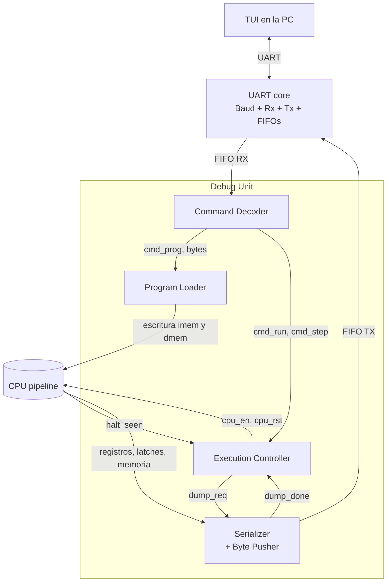

# Arquitectura general

Up: [Índice](INDEX.md)

## Objetivo

El enunciado pide tres cosas: el pipeline RISC-V, una **Debug Unit** que permita enviar y recibir información del procesador por UART, y una interfaz en la PC para visualizar los datos e interactuar con la Debug Unit. Esta documentación cubre la Debug Unit y la interfaz; el pipeline (5 etapas, sin control de riesgos en la primera versión).

## Requerimientos del enunciado que condicionan el diseño

- El procesador se programa y reprograma **por UART, sin resintetizar**.
- **El clock no puede intervenirse** en ninguna parte del proyecto. Consecuencia: el paso a paso se hace con *clock enable*, nunca con clock gating (ver [Registro de decisiones](10-decisiones.md)).
- Se envían a la PC el contenido de los **32 registros**, de los **latches intermedios** y de la **memoria de datos usada**.
- El programa se escribe en ensamblador, se traduce a código máquina y debe tener una instrucción **HALT**.
- Dos modos: **continuo** (corre hasta el final y muestra todo) y **paso a paso** (un comando = un ciclo de clock). En ambos, el pipeline debe quedar **vacío** al terminar.
- Hay que documentar las decisiones y su porqué.

## Diagrama de bloques

## Responsabilidad de cada bloque

| Bloque | Responsabilidad | Nota |
|---|---|---|
| [UART core](03-uart-core.md) | Serializar y deserializar bytes, con FIFOs | Reutilizado |
| [Command Decoder](04-command-decoder.md) | Interpretar comandos `p`, `c`, `s` y distribuirlos | No conoce el estado del CPU |
| [Program Loader](05-program-loader.md) | Escribir la memoria de programa, rellenar con HALT y borrar la memoria de datos | Dos FSM en paralelo |
| [Execution Controller](06-execution-controller.md) | Manejar `cpu_en` y `cpu_rst`; decidir cuándo termina una ejecución | Único dueño de `cpu_en` |
| [Serializer](07-serializer.md) | Convertir el estado congelado del CPU en tramas de bytes | Único escritor de la FIFO TX |

## Flujos

**Programar** (`p`): el Decoder avisa al Controller (que resetea el CPU) y al Loader (que escribe la memoria de programa, rellena con HALT y borra la memoria de datos). El CPU queda detenido con `nwords` instrucciones válidas.

**Continuo** (`c`): el Controller habilita el CPU hasta que detecta HALT y deja correr el pipeline unos ciclos más (drenaje). Después congela el CPU y pide un snapshot al Serializer.

**Paso a paso** (`s`): el Controller habilita el CPU durante un solo ciclo, congela, y pide el snapshot.

En los tres casos, mientras se envía el snapshot el CPU está congelado (`cpu_en = 0`), así que todo lo que se lee es coherente entre sí.

Related: [Protocolo UART](02-protocolo-uart.md), [Contrato con el CPU](08-contrato-cpu.md), [Registro de decisiones](10-decisiones.md)

---