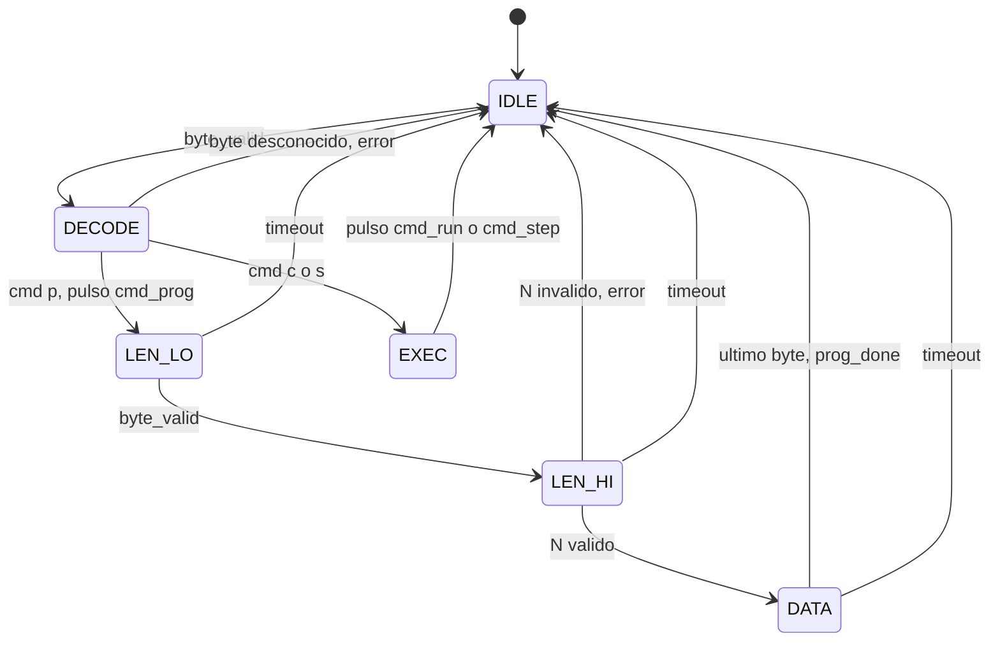

# Command Decoder

Up: [Índice](INDEX.md)

Lee bytes de la FIFO RX, interpreta el comando y emite pulsos hacia el [Program Loader](05-program-loader.md) y el [Execution Controller](06-execution-controller.md). Código: `Command_Decoder.v` (simulado con Icarus Verilog contra la FIFO real, 0 errores).

## Estructura: dos mini-FSM

### 1. Byte Fetcher (2 estados)

Es el único que toca la FIFO RX y entrega `byte_valid` (pulso de 1 ciclo) con el byte.

| Estado | Condición | Siguiente | Salida |
|---|---|---|---|
| `F_IDLE` | `!i_rx_empty` | `F_REQ` | |
| `F_REQ` | `i_rx_done` | `F_IDLE` | `byte_valid`; `o_rx_read = !i_rx_done` |

`o_rx_read` se mantiene alto hasta que llega `done` (la FIFO solo muestrea `i_read` en `IDLE`; ver [UART core](03-uart-core.md)).

### 2. FSM de comandos (6 estados)

| Estado | Condición | Siguiente | Salidas / acción |
|---|---|---|---|
| `IDLE` | `byte_valid` | `DECODE` | guarda el byte en `cmd` |
| `DECODE` | `cmd == 'p'` | `LEN_LO` | pulso `cmd_prog`; `nwords <= 0` |
| | `cmd == 'c'` o `'s'` | `EXEC` | |
| | otro | `IDLE` | pulso `error` |
| `EXEC` | siempre | `IDLE` | pulso `cmd_run` o `cmd_step` |
| `LEN_LO` | `byte_valid` | `LEN_HI` | guarda `len_lo` |
| `LEN_HI` | `byte_valid`, N válido | `DATA` | `nwords <= N`; `remaining <= 4·N` |
| | `byte_valid`, N inválido | `IDLE` | pulso `error` |
| `DATA` | `byte_valid`, quedan bytes | `DATA` | pulso `ld_valid`; `remaining--` |
| | `byte_valid`, último byte | `IDLE` | `ld_valid` y pulso `prog_done` |
| `LEN_LO`, `LEN_HI`, `DATA` | timeout sin bytes | `IDLE` | pulso `error`; `nwords <= 0` |

Un `byte_valid` y un timeout simultáneos se resuelven a favor del byte.

## Señales

| Señal | Dir | Destino / origen |
|---|---|---|
| `i_rx_data[7:0]`, `i_rx_empty`, `i_rx_done` | in | FIFO RX (`o_data`, `o_empty`, `o_done_read`) |
| `o_rx_read` | out | FIFO RX (`i_read`) |
| `o_cmd_prog`, `o_cmd_run`, `o_cmd_step` | out (pulsos) | Execution Controller |
| `o_ld_valid`, `o_ld_byte[7:0]`, `o_prog_done` | out | Program Loader |
| `o_nwords[15:0]` | out (nivel) | Controller; 0 = sin programa válido |
| `o_error` | out (pulso) | Opcional (comando desconocido, longitud inválida o timeout) |

Parámetros: `NB_DATA` (8), `IMEM_DEPTH`, `CLK_FREQ_HZ`, `TIMEOUT_MS` (50).

## Decisiones de diseño

- **No conoce el estado del CPU.** Si llega un `c` o `s` en un momento inadecuado, solo emite el pulso y decide el Controller. Esto desacopla ambos bloques.
- **`p` siempre es válido.** El pulso `cmd_prog` frena y resetea el CPU.
- **`o_nwords` es un nivel**: vale 0 al empezar un `p`, ante longitud inválida y ante timeout. El Controller no ejecuta si vale 0.
- **No escribe en la FIFO TX.** Solo el [Serializer](07-serializer.md) escribe, así que no hay arbitraje.
- **El Decoder cuenta bytes y el Loader arma las palabras**, de modo que el Decoder no conoce el ancho de instrucción.
- **Timeout de 50 ms** entre bytes durante un `p`, para que una pérdida de bytes no cuelgue la FSM.

## Pruebas realizadas

Testbench con la FIFO real: carga de 2 instrucciones (orden de bytes y `prog_done`), `c` y `s`, comando desconocido y continuidad posterior, longitud inválida (512 mayor que `IMEM_DEPTH`) y `N = 0`, timeout a mitad de carga y recuperación, y recarga con un programa más corto.

## Pendiente

Cambiar la condición de N válido a `N <= IMEM_DEPTH - 1`, para que siempre quede lugar para un HALT (ver [Program Loader](05-program-loader.md)). Hoy el código acepta hasta `IMEM_DEPTH`.

Related: [Protocolo UART](02-protocolo-uart.md), [UART core](03-uart-core.md), [Program Loader](05-program-loader.md), [Execution Controller](06-execution-controller.md)
