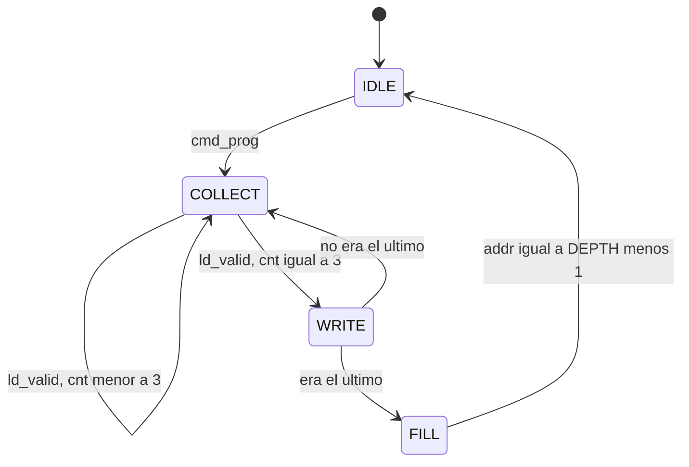

# Program Loader

Up: [Índice](INDEX.md)

Convierte el flujo de bytes del [Command Decoder](04-command-decoder.md) en el contenido de las memorias y deja el sistema en un estado limpio antes de ejecutar. Hace tres tareas:

1. Arma palabras de 32 bits y las escribe en la **memoria de programa**.
2. **Rellena con HALT** el resto de la memoria de programa.
3. **Pone en cero la memoria de datos** (`CLEAR`).

## Dos FSM independientes

El borrado de la memoria de datos es una FSM aparte (en lugar de un estado más de la principal). Si fuera un estado de la FSM principal, mientras barre la memoria el Loader no escucharía `ld_valid`, que es un pulso de un ciclo. En la práctica no pasaría (entre `p` y el primer byte hay al menos 3 tiempos de byte), pero depender de eso es frágil si la memoria crece. Con dos FSM cada una usa su propio puerto y no hay supuestos de temporización.

### FSM A: carga de la memoria de programa (4 estados)

| Estado | Qué hace | Siguiente |
|---|---|---|
| `IDLE` | Espera `cmd_prog`; `busy = 0` | `COLLECT` |
| `COLLECT` | Con cada `ld_valid` desplaza el byte en `word`; guarda `last <= prog_done` | `WRITE` al 4.º byte |
| `WRITE` | Un ciclo con `imem_we = 1`; luego `addr++` | `COLLECT`, o `FILL` si `last` |
| `FILL` | Escribe `HALT_WORD` en cada dirección restante, una por ciclo | `IDLE` |

`cmd_prog` desde cualquier estado reinicia la FSM (`addr <= 0`, `cnt <= 0`): es la salida de emergencia.

**Armado de la palabra.** Registro de desplazamiento: `word <= {byte, word[31:8]}`. Como los bytes llegan LSB primero (little-endian), tras 4 desplazamientos el primer byte quedó en `word[7:0]`, sin decodificar índices.

**Última palabra.** El Decoder activa `prog_done` en el mismo ciclo que `ld_valid` del último byte, así que el Loader no necesita conocer `N`.

### FSM B: borrado de la memoria de datos (2 estados)

| Estado | Qué hace | Siguiente |
|---|---|---|
| `D_IDLE` | Espera `cmd_prog`; `daddr <= 0` | `D_CLEAR` |
| `D_CLEAR` | `dm_we = 1`, `dm_data = 0`, `dm_addr = daddr`; `daddr++` | `D_IDLE` cuando `daddr == DMEM_DEPTH - 1` |

Se dispara con el mismo `cmd_prog` y corre mientras llegan los bytes del programa.

## Señales

| Señal | Dir | Descripción |
|---|---|---|
| `cmd_prog`, `ld_valid`, `ld_byte`, `prog_done` | in | Del Decoder |
| `imem_we`, `imem_addr`, `imem_data` | out | Puerto de escritura de la memoria de programa |
| `dm_we`, `dm_addr`, `dm_data` | out | Puerto de escritura de la memoria de datos (nuevo; ver [contrato](08-contrato-cpu.md)) |
| `busy` | out | 1 si cualquiera de las dos FSM no está en `IDLE` |

Parámetros: `IMEM_DEPTH`, `DMEM_DEPTH`, `HALT_WORD`.

## Línea de tiempo (3 instrucciones, 115200 baudios, 100 MHz)

| Instante | Qué pasa |
|---|---|
| 0 | `cmd_prog`; se reinician las dos FSM |
| 0 a 2,5 µs | `CLEAR` pone la memoria de datos en cero (256 palabras) |
| ~260 µs | Llega el primer byte de programa |
| ~1,3 ms | Llega el último byte; `WRITE` y `FILL` (~250 ciclos) |
| +3 µs | `busy` baja; ya puede aceptarse `c` o `s` |

Casi todo el tiempo es esperar bytes de la UART.

## Reglas de interacción

- **`busy` frena la ejecución.** El Controller usa `prog_ok = (nwords != 0) && !busy`.
- **Propiedad de los puertos.** Mientras `busy = 1`, los puertos de escritura de ambas memorias son de la Debug Unit (mux con prioridad a ella). Así una escritura pendiente del CPU no ensucia la memoria recién borrada.
- **Carga abortada** (timeout): el Decoder deja `nwords = 0`, así que no se ejecuta. El siguiente `p` lo sobrescribe todo, incluido el `FILL`.
- **Programa más corto que el anterior:** el `FILL` pisa lo que quedaba, así que no se ejecutan restos.

## Cambios que esto exige en otros bloques

1. [Command Decoder](04-command-decoder.md): aceptar `N <= IMEM_DEPTH - 1`.
2. Memoria de datos: puerto de escritura extra desde la Debug Unit.
3. **Codificación de HALT:** `ebreak` (`0x00100073`) es la opción estándar, aunque es un opcode SYSTEM fuera de la lista de instrucciones a implementar. La misma palabra tiene que estar en el `FILL`, en el decoder del CPU (que activa `halt_seen`) y en el ensamblador; por eso `HALT_WORD` es un parámetro.

Related: [Command Decoder](04-command-decoder.md), [Execution Controller](06-execution-controller.md), [Contrato con el CPU](08-contrato-cpu.md), [Registro de decisiones](10-decisiones.md)
