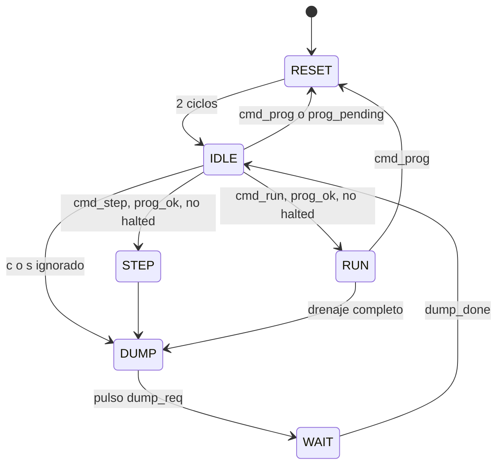

# Execution Controller

Up: [Índice](INDEX.md)

Decide **cuándo avanza el CPU y cuándo se saca una foto de su estado**. Es el único bloque que maneja `cpu_en` y `cpu_rst`, y el que sabe cuándo terminó una ejecución.

## FSM (6 estados)

| Estado | Condición | Siguiente | Salidas / acción |
|---|---|---|---|
| `RESET` | pasaron `RESET_CYCLES` (2) | `IDLE` | `cpu_rst = 1`; limpia `drain_cnt`, `halt_lat`, `dirty`, `prog_pending` |
| `IDLE` | `cmd_prog` o `prog_pending` | `RESET` | |
| | `cmd_step && prog_ok && !halted` | `STEP` | |
| | `cmd_run && prog_ok && !halted` | `RUN` | |
| | `c` o `s` pero `halted` o sin programa válido | `DUMP` | sin habilitar el CPU |
| `STEP` | siempre | `DUMP` | `cpu_en = 1` durante un ciclo |
| `RUN` | `cmd_prog` | `RESET` | `cpu_en = 1`; salida de emergencia |
| | `halting && drain_cnt == DRAIN - 1` | `DUMP` | último ciclo habilitado del drenaje |
| `DUMP` | siempre | `WAIT` | pulso `dump_req` |
| `WAIT` | `dump_done` | `IDLE` | |

`prog_ok = (nwords != 0) && !ld_busy`.

## El drenaje

El enunciado exige que el pipeline quede **vacío** al terminar. No alcanza con detectar HALT: hay que dejar avanzar el CPU hasta que HALT salga de WB.

- HALT se detecta en ID; le faltan EX, MEM y WB. Con el ciclo de ID, son 4 ciclos habilitados: `DRAIN = 4` (parámetro, por si cambia el pipeline).
- `drain_cnt` cuenta los ciclos habilitados desde que HALT apareció. Cuando llega a `DRAIN`, `halted = 1`.
- El Controller tiene su **propio latch** (`halt_lat`): `halting = halt_seen | halt_lat`. Así no depende de si el CPU mantiene `halt_seen` alto o solo un ciclo.
- **Un solo mecanismo para `c` y `s`.** En paso a paso, el CPU queda `halted` recién cuando el pipeline se vació, tras los pasos de drenaje; los `s` posteriores se ignoran.

Ejemplo (modo continuo, K instrucciones hasta HALT incluido): HALT llega a ID en el ciclo K + 1; los ciclos K + 1 a K + 4 son los 4 de drenaje, y el último es el que saca a HALT de WB. Después `DUMP`. La duración total en `RUN` es **K + 4** ciclos.

## Detalles de implementación

- **`cpu_en` sale de un flop**, calculado desde el estado siguiente: `cpu_en <= (state_next == RUN || state_next == STEP)`. Maneja el CE de todo el pipeline y no conviene que sea lógica combinacional larga.
- **`prog_pending`** (un flop): si `cmd_prog` llega en `STEP`, `DUMP` o `WAIT`, el pulso de un ciclo se perdería. Se recuerda y se atiende al volver a `IDLE`.
- **Flags para la trama `S`:** `halted`; `pipe_empty = !dirty || halted` (`dirty` se activa con el primer `cpu_en` tras un reset); y `running`, que hoy siempre vale 0 en lo que ve la TUI porque el snapshot solo sale con el CPU detenido.
- Mientras se envía el snapshot (`DUMP` y `WAIT`), `cpu_en = 0`.

## Decisión: `c` o `s` ignorado responde con snapshot

Si el CPU ya está en HALT (o no hay programa) y llega un `c` o `s`, el Controller hace igual un `DUMP` sin habilitar el CPU. La TUI recibe un snapshot con `halted = 1` y sabe por qué no avanzó, sin agregar comandos ni respuestas nuevas. Para volver a ejecutar el mismo programa hay que reenviar `p` (~1,3 ms a 115200). Si resulta incómodo, un comando `x` (reset sin recargar) encaja sin tocar nada de lo anterior.

## Limitaciones conocidas

- **`p` durante un volcado:** el Loader empezaría a borrar la memoria de datos mientras se la lee, y el final del volcado saldría con ceros. No hay control de flujo en la UART, así que se resuelve por protocolo: la TUI no manda comandos hasta recibir la trama `M` (ver [Protocolo UART](02-protocolo-uart.md)). `prog_pending` solo garantiza que el CPU se resetee después.
- **Si `dump_done` nunca llegara**, `WAIT` quedaría colgado. Es un error de integración, no un caso de uso; no se agregó timeout.

## Requisitos sobre el CPU

Ver el detalle en [Contrato con el CPU](08-contrato-cpu.md).

1. Después de HALT no se ejecuta nada: el PC se congela y lo que entra detrás son burbujas que no escriben registros ni memoria.
2. `cpu_en` apaga todo, incluidos los write-enable del regfile y de la memoria de datos.
3. Los puertos de lectura de debug funcionan con `cpu_en = 0`.
4. `cpu_rst` es síncrono y deja en cero PC, latches, registros y el contador de memoria usada.

Related: [Command Decoder](04-command-decoder.md), [Program Loader](05-program-loader.md), [Serializer](07-serializer.md), [Contrato con el CPU](08-contrato-cpu.md)
