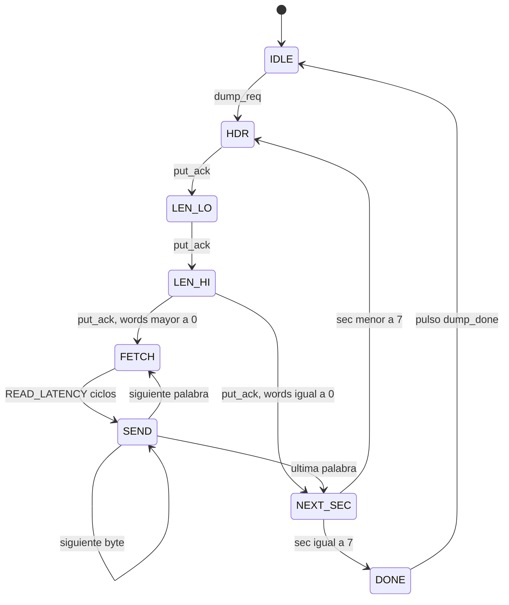

# Serializer

Up: [Índice](INDEX.md)

Toma el estado congelado del CPU y lo convierte en tramas de bytes para la TUI. Es el **único que escribe en la FIFO TX**, así que nada se intercala dentro de un snapshot. Se activa con `dump_req` del [Execution Controller](06-execution-controller.md).

## Las 8 secciones

| sec | Header | Palabras | Fuente de cada palabra |
|---|---|---|---|
| 0 | `S` | 1 | `{29'b0, pipe_empty, halted, running}` (flags capturados en `IDLE`) |
| 1 | `C` | 1 | `cpu_pc` |
| 2 | `R` | 32 | `rf_data`, con `rf_addr = word_idx` |
| 3 | `I` | NW | bus `latch_if_id`, palabra `word_idx` |
| 4 | `D` | NW | bus `latch_id_ex` |
| 5 | `E` | NW | bus `latch_ex_mem` |
| 6 | `W` | NW | bus `latch_mem_wb` |
| 7 | `M` | `mem_used_words` | `dm_data`, con `dm_addr = word_idx` |

- Todo viaja en **palabras de 32 bits**, incluso los latches. El bus se rellena con ceros hasta el siguiente múltiplo de 32 (`NW = ceil(ancho / 32)`).
- **El orden de los campos dentro de cada bus** tiene que coincidir con la tabla `LATCHES` de `protocol.py` (por ejemplo `latch_if_id = {instr, pc}`, con `pc` en los bits bajos). Hay que acordarlo con el pipeline.
- **`M` es siempre la última sección**, aunque tenga longitud 0 (marcador de fin para la TUI).

## FSM principal (8 estados)

| Estado | Condición | Siguiente | Qué hace |
|---|---|---|---|
| `IDLE` | `dump_req` | `HDR` | Captura `flags_r` y `used_r` (= `mem_used_words`); `sec <= 0`, `word_idx <= 0` |
| `HDR` | `put_ack` | `LEN_LO` | Emite el header; carga `words_left` |
| `LEN_LO` | `put_ack` | `LEN_HI` | Emite `(4 · words)[7:0]` |
| `LEN_HI` | `put_ack`, `words > 0` | `FETCH` | Emite `(4 · words)[15:8]` |
| | `put_ack`, `words == 0` | `NEXT_SEC` | |
| `FETCH` | pasaron `READ_LATENCY` ciclos | `SEND` | `word <= rd_mux`; `byte_idx <= 0` |
| `SEND` | `put_ack`, `byte_idx < 3` | `SEND` | Emite `word[8·byte_idx +: 8]`; `byte_idx++` |
| | `put_ack`, `byte_idx == 3`, `words_left > 1` | `FETCH` | `word_idx++`, `words_left--` |
| | `put_ack`, `byte_idx == 3`, `words_left == 1` | `NEXT_SEC` | |
| `NEXT_SEC` | `sec < 7` | `HDR` | `sec++`, `word_idx <= 0` |
| | `sec == 7` | `DONE` | |
| `DONE` | siempre | `IDLE` | Pulso `dump_done` |

**Lectura de memoria.** `rf_addr` y `dm_addr` salen de `word_idx`, que se actualiza antes de entrar a `FETCH`. Como la lectura es síncrona (1 ciclo en una BRAM), `FETCH` espera `READ_LATENCY` ciclos (1 por defecto, 0 si el regfile es combinacional). Capturar en el registro `word` evita que el camino memoria, mux de byte y FIFO limite el clock.

## Byte Pusher (2 estados)

Contraparte del Byte Fetcher del [Command Decoder](04-command-decoder.md). Evita las escrituras perdidas de la FIFO (ver [UART core](03-uart-core.md)).

| Estado | Condición | Siguiente | Salidas |
|---|---|---|---|
| `P_IDLE` | `put && !full` | `P_REQ` | |
| `P_REQ` | `done_write` | `P_IDLE` | `o_write = !done_write`; `put_ack` = pulso al recibir `done_write` |

El Serializer presenta `put = 1` y `put_byte` y los **mantiene estables** hasta ver `put_ack`, así `i_data` de la FIFO no cambia con la escritura pendiente. Si la FIFO está llena, el Pusher espera y eso frena al Serializer.

## Contrapresión

No hace falta una FIFO TX grande. El snapshot sale a la velocidad de la UART y, cuando la FIFO se llena, el Pusher espera. El Serializer usa unos 5 ciclos por byte contra ~8700 de la UART, así que casi todo el tiempo espera. Tamaño y duración del snapshot: ver [Protocolo UART](02-protocolo-uart.md).

## Señales

| Señal | Dir | Descripción |
|---|---|---|
| `dump_req` | in | Pulso del Controller |
| `flags[2:0]`, `cpu_pc`, `mem_used_words` | in | Estado del CPU y del Controller |
| `latch_if_id`, `latch_id_ex`, `latch_ex_mem`, `latch_mem_wb` | in | Buses planos, cada uno con su `pc` |
| `rf_data`, `dm_data` | in | Datos de lectura de debug |
| `tx_full`, `tx_done_write` | in | De la FIFO TX |
| `rf_addr[4:0]`, `dm_addr` | out | Direcciones de lectura de debug |
| `tx_write`, `tx_data[7:0]` | out | A la FIFO TX |
| `dump_done` | out | Pulso al Controller |

Parámetros: `W_IF_ID`, `W_ID_EX`, `W_EX_MEM`, `W_MEM_WB` (anchos en bits), `DMEM_AW`, `READ_LATENCY`.

## Reglas de interacción

- **Captura en `IDLE`:** `flags_r` y `used_r` se guardan para que la longitud de `M` quede fija durante todo el snapshot. El resto se lee en vivo porque el CPU está congelado.
- **Respuestas `K` y `N` (opcionales):** solo pueden salir desde `IDLE`, porque un byte en medio de una trama rompería el parser de la TUI. Se recordarían con un flag `resp_pending`.
- **Sin timeout:** si la UART TX no drena, el Serializer espera. Es un error de integración, no un caso de uso.

Related: [Execution Controller](06-execution-controller.md), [Protocolo UART](02-protocolo-uart.md), [Contrato con el CPU](08-contrato-cpu.md), [UART core](03-uart-core.md)
